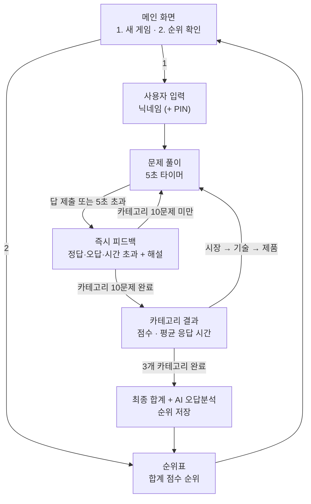

# 온라인 철강 상식 스피드 퀴즈 대회 PRD

2026-09-29 · 기반: 철강 퀴즈 게임(`PRD.md`, 웹 버전)의 문제 은행과 규칙
개정 2026-09-29: 순위 저장소를 Google Sheets로 확정(7장), OpenAI 모델·호출 옵션을 API 설정값으로 정하도록 변경(6장)

## 1. 개요

참가자가 휴대폰 브라우저로 접속해 시장·기술·제품 3개 카테고리를 10문제씩, 문제당 5초 안에 푸는 온라인 스피드 퀴즈 대회다. 세 카테고리 점수를 합친 총점으로 순위를 가리고, 끝나면 OpenAI Chat API가 틀린 문제를 분석해 총점과 함께 보여 준다. Python Streamlit으로 만들어 GitHub 저장소에서 배포한다.

**목표**

- 사내·외 참가자가 설치 없이 모바일 웹으로 참여하는 철강 상식 대회를 운영한다.
- 5초 제한으로 긴장감을 주고, 즉시 피드백과 AI 오답분석으로 대회를 학습으로 이어지게 한다.
- 3개 카테고리 합계로 순위를 매겨 공정하게 우승자를 가린다.

**기존 웹 버전과 달라지는 점**

| 항목 | 웹 버전 (`PRD.md`) | 스피드 퀴즈 대회 (이 문서) |
| --- | --- | --- |
| 구현 | HTML·CSS·JS 정적 사이트 | Python Streamlit |
| 한 판 | 카테고리 1개 선택, 10문제 | 3개 카테고리 연속, 10문제 × 3 = 30문제 |
| 제한 시간 | 없음 | 문제당 5초 |
| 순위 | 카테고리별, 같은 브라우저 안에서만 | 3개 카테고리 합계, 모든 참가자 공유 |
| 결과 | 점수·정답률·오답 목록 | 카테고리별 결과 + 합계 + AI 오답분석 |

## 2. 대상 사용자

| 사용자 | 목적 | 주요 장면 |
| --- | --- | --- |
| 대회 참가자(임직원·학생·일반인) | 순위 경쟁, 철강 상식 점검 | 휴대폰으로 링크를 열어 한 번에 30문제 풀이 |
| 대회 운영자(교육·홍보 담당) | 대회 개최, 순위 발표 | 링크 배포, 순위표 화면을 행사장에 띄움 |
| 개발·유지보수 담당 | 문제 관리, 배포 | GitHub에 문제 추가 후 재배포 |

**대표 시나리오:** 사내 행사 공지 링크를 받은 직원이 점심시간에 휴대폰으로 접속해 닉네임을 입력하고 30문제를 푼다. 끝나면 총점 250점, 순위 7위와 "기술 카테고리의 열처리 개념이 약합니다" 같은 오답분석을 본다. 운영자는 행사 마감 후 메뉴 2 순위표로 상위 입상자를 발표한다.

## 3. 게임 규칙

- **구성:** 시장 → 기술 → 제품 순서로 카테고리마다 10문제, 총 30문제. 문제는 카테고리 문제 은행(현재 각 40문제)에서 무작위로 뽑고, 보기 순서도 섞는다.
- **형식:** 4지선다, 정답 1개.
- **제한 시간:** 문제당 5초. 5초 안에 답하지 않으면 시간 초과로 오답 처리한다.
- **타이머 범위:** 타이머는 문제가 화면에 보인 순간부터 답을 제출할 때까지만 흐른다. 피드백 화면과 카테고리 결과 화면에서는 멈춘다.
- **점수:** 정답 1개당 10점, 오답·시간 초과 0점(감점 없음). 카테고리 만점 100점, 합계 만점 300점.
- **순위:** 합계 점수 높은 순 → 같으면 30문제 총 응답 시간(초, 소수 첫째 자리) 짧은 순 → 같으면 먼저 완주한 순.
- **기록 인정:** 30문제를 끝까지 푼 판만 순위에 반영한다. 중간에 나가거나 새로고침으로 판이 끊기면 기록하지 않는다.

## 4. 기능 요구사항

| ID | 요구사항 | 상세 | 우선순위 |
| --- | --- | --- | --- |
| S-01 | 메인 메뉴 | 메인 화면에 "1. 새 게임", "2. 순위 확인" 두 메뉴와 대회 규칙 요약(30문제, 문제당 5초, 합계 순위) 표시 | P0 |
| S-02 | 사용자 입력 | 새 게임 시작 전 닉네임 입력. 2~12자, 앞뒤 공백 제거, 금칙어 필터(웹 버전 규칙 재사용). 이미 순위에 있는 닉네임은 안내 후 다른 이름을 요청(4장 S-12 참고) | P0 |
| S-03 | 카테고리 연속 진행 | 시장 → 기술 → 제품 순서로 10문제씩 자동 진행. 상단에 "기술 · 3 / 10", 전체 진행률(13 / 30) 표시 | P0 |
| S-04 | 5초 타이머 | 문제마다 남은 시간을 초 단위로 표시하고 줄어드는 막대로 보여 준다. 0초가 되면 자동으로 시간 초과 처리 | P0 |
| S-05 | 서버 기준 시간 판정 | 문제를 보여 준 시각을 서버(세션)에 기록하고, 답 제출 시 서버 시각과 비교해 5초를 넘으면 시간 초과로 처리한다. 화면 타이머가 늦게 갱신되거나 조작돼도 판정은 서버 기준 | P0 |
| S-06 | 즉시 피드백 | 답하거나 시간이 초과되면 바로 정답/오답/시간 초과 표시, 정답 보기 강조, 1~2문장 해설. "다음 문제" 버튼으로 진행 | P0 |
| S-07 | 카테고리 결과 | 카테고리 10문제가 끝날 때마다 해당 카테고리 점수·정답 수·평균 응답 시간 표시 후 "다음 카테고리" 버튼 | P0 |
| S-08 | 최종 합계 | 30문제 후 카테고리별 점수, 합계(300점 만점), 총 응답 시간, 현재 순위 표시 | P0 |
| S-09 | AI 오답분석 | 최종 결과 화면에서 틀린 문제·시간 초과 문제를 OpenAI Chat API에 보내 약점 분석과 학습 추천을 받아 합계와 함께 표시(6장) | P0 |
| S-10 | 순위표 (메뉴 2) | Google Sheets에 쌓인 기록으로 계산한 전체 참가자 합계 순위: 순위, 닉네임, 합계, 카테고리별 점수, 총 응답 시간, 완주 일시. 상위 20명과 내 순위(20위 밖이어도) 표시. 마지막 갱신 시각과 새로고침 버튼 표시(7장 캐시) | P0 |
| S-11 | 오답 다시보기 | 최종 결과에서 틀린 문제 목록(내 답, 정답, 해설) 펼쳐 보기 | P1 |
| S-12 | 닉네임 보호 | 닉네임과 함께 4자리 PIN을 받아, 같은 닉네임으로 다시 참가할 때 PIN이 맞아야 기록을 인정. 시트에는 PIN 대신 해시만 저장 | P1 |
| S-13 | 운영자 기능 | 운영자 비밀번호(`st.secrets`)로 대회 마감(마감 후 새 게임 차단)과 새 대회 시작(새 시트 탭으로 전환, 7장). 기록 확인·CSV 내려받기는 운영자가 Google Sheets에서 직접 한다 | P1 |
| S-14 | 저장 실패 복구 | 순위 저장이 실패하면 결과 화면에 안내와 "다시 저장" 버튼을 보여 주고, 결과는 세션에 보관해 다시 풀지 않아도 되게 한다 | P0 |

P0 = 대회 개최 필수, P1 = 개최 권장.

## 5. 동작 흐름과 화면



| 화면 | 주요 구성 |
| --- | --- |
| 메인 | 대회 제목, 규칙 요약, 메뉴 1·2 버튼(모바일에서 누르기 쉬운 큰 버튼), 대회 마감 시 안내 |
| 사용자 입력 | 닉네임 입력, (P1) PIN 입력, 시작 버튼, 입력 오류 안내 |
| 문제 풀이 | 카테고리·문항 번호, 전체 진행률, 남은 시간(숫자 + 막대, 2초 이하일 때 색 변경), 문제, 보기 버튼 4개 |
| 즉시 피드백 | 결과 문구(정답!/오답/시간 초과)와 아이콘, 정답 강조, 해설, 응답 시간, 다음 버튼 |
| 카테고리 결과 | 카테고리 점수, 정답 수, 평균 응답 시간, 다음 카테고리 버튼 |
| 최종 결과 | 카테고리별 점수, 합계, 총 응답 시간, 현재 순위, AI 오답분석 카드, 오답 다시보기, 순위표·메인 버튼 |
| 순위표 | 순위표, 내 순위 강조, 새로고침 버튼 |

## 6. AI 오답분석 (OpenAI Chat API)

- **호출 시점:** 최종 결과 화면에서 판마다 1번. 틀린 문제가 없으면 호출하지 않고 "만점" 축하 문구만 보여 준다.
- **보내는 내용:** 카테고리별 점수, 틀린·시간 초과 문제마다 카테고리·난이도·질문·내 답(또는 시간 초과)·정답·해설. **닉네임 등 개인정보는 보내지 않는다.**
- **요청하는 결과:** 한국어, 500자 이내로
  1. 약한 카테고리와 개념 요약
  2. 틀린 문제에서 드러난 오해 2~3가지
  3. 다음에 공부할 주제 3가지
  4. 짧은 격려 한 문장
- **표시:** 합계 점수 카드 바로 아래 "AI 오답분석" 카드. 분석을 기다리는 동안 합계는 먼저 보여 주고, 분석 자리에는 로딩 표시를 둔다.
- **실패 처리:** 설정이 빠졌거나 호출 실패·시간 초과면 "오답분석을 불러오지 못했습니다" 안내만 하고 합계와 오답 목록은 정상 표시한다. 게임 진행이나 순위 저장에는 영향이 없어야 한다.
- **설정 우선 원칙:** 모델 이름과 호출 옵션은 코드에 고정하지 않고 모두 API 설정값을 따른다. 모델을 바꾸거나 비용을 조절할 때 코드를 고치지 않고 설정만 바꾸면 된다.

  | 설정 키 | 필수 | 설명 |
  | --- | --- | --- |
  | `OPENAI_API_KEY` | 필수 | OpenAI API 키 |
  | `OPENAI_MODEL` | 필수 | 사용할 채팅 모델 이름. 없으면 오답분석 기능을 끄고 결과 화면에 "오답분석이 설정되지 않았습니다"라고 표시 |
  | `OPENAI_BASE_URL` | 선택 | 사내 프록시나 호환 엔드포인트를 쓸 때의 주소. 없으면 SDK 기본 주소 |
  | `OPENAI_MAX_OUTPUT_TOKENS` | 선택 | 응답 최대 길이(비용 상한). 없으면 API 기본값 |
  | `OPENAI_TEMPERATURE` | 선택 | 응답 다양성. 없으면 API 기본값 |
  | `OPENAI_TIMEOUT_SEC` | 선택 | 호출 제한 시간. 없으면 15초 |

- **설정 읽는 순서:** 배포 환경의 Secrets(`st.secrets`) → 환경 변수 → 로컬 `.env`(`python-dotenv`). 같은 키가 여러 곳에 있으면 앞의 것을 쓴다. 저장소에는 값이 빈 `.env.example`만 올린다.
- **비용 관리:** 판당 1회만 호출하고, 같은 판에서 새로고침해도 다시 호출하지 않도록 결과를 세션에 저장한다. 판당 비용 한도는 `OPENAI_MODEL`과 `OPENAI_MAX_OUTPUT_TOKENS`로 조절한다.

## 7. 순위 저장소 (Google Sheets)

모든 참가자의 완주 기록을 Google 스프레드시트 하나에 쌓고, 앱은 이 시트를 읽어 순위를 계산한다. 운영자는 별도 관리 화면 없이 시트를 열어 기록을 보고 내려받을 수 있다.

- **구성:** 스프레드시트 1개에 대회마다 워크시트 탭 1개. 탭 이름은 설정값 `CONTEST_ID`(예: `2026-autumn`)이고, 탭이 없으면 앱이 머리글 행과 함께 만든다.
- **기록 방식:** 30문제를 완주할 때마다 행 1개를 **추가만** 한다. 기존 행은 수정·삭제하지 않으므로 여러 사람이 동시에 저장해도 서로 덮어쓰지 않는다.
- **열 구성**

  | 열 | 내용 |
  | --- | --- |
  | `completed_at` | 완주 일시 (ISO 8601, 한국 시간) |
  | `game_id` | 판 고유 id (같은 판이 두 번 저장되는 것을 막는 데 사용) |
  | `nickname` | 닉네임 |
  | `pin_hash` | PIN 해시 (S-12, 쓰지 않으면 빈칸) |
  | `market`, `tech`, `product` | 카테고리별 점수 |
  | `total` | 합계 점수 |
  | `total_time_sec` | 30문제 총 응답 시간(초, 소수 첫째 자리) |
  | `app_version` | 기록한 앱 버전 |

- **순위 계산:** 앱이 탭 전체를 읽어 닉네임별 최고 기록 1개를 고른 뒤, 3장의 정렬 규칙(합계 → 총 응답 시간 → 완주 일시)으로 정렬한다. 같은 `game_id`가 여러 행이면 하나만 센다.
- **인증:** Google Cloud 서비스 계정을 만들고, 스프레드시트를 서비스 계정 이메일에 **편집자**로 공유한다. 서비스 계정 JSON 키는 Secrets의 `[gcp_service_account]` 항목에, 스프레드시트 주소는 `SHEET_URL`에 넣는다. 라이브러리는 `gspread`와 `google-auth`를 쓴다.
- **요청 한도 대응:** Google Sheets API는 분당 읽기·쓰기 요청 수에 한도가 있고, 모든 요청이 서비스 계정 하나로 나가므로 사용자별 한도가 곧 앱 전체 한도가 된다. 그래서 다음처럼 요청을 줄인다.
  - 순위 읽기는 캐시한다(예: 30초, `st.cache_data`). 기록을 저장한 직후에는 캐시를 비워 바로 반영한다.
  - 쓰기는 판당 1번만 한다.
  - 한도 초과(HTTP 429)나 일시 오류면 간격을 늘려 가며 최대 3번 다시 시도하고, 그래도 실패하면 S-14로 안내한다.
  - 구현 전에 최신 할당량을 확인하고, 동시 50명 완주 상황으로 부하 시험을 한다.
- **닉네임 중복 확인(S-02):** 입력한 닉네임을 캐시된 순위 데이터와 비교한다. 캐시 때문에 몇십 초 사이에 같은 닉네임이 겹칠 수 있으므로, P1의 PIN으로 본인 여부를 가린다.
- **PIN 보관:** PIN은 서버 비밀값 `PIN_SALT`와 합쳐 SHA-256으로 해시한 값만 저장한다.
- **새 대회 시작(S-13):** `CONTEST_ID`를 바꾸면 새 탭에 기록이 쌓인다. 이전 대회 기록은 이전 탭에 그대로 남는다.
- **권한:** 스프레드시트는 운영자와 서비스 계정만 접근하게 공유한다(링크 공개 금지).

## 8. 문제 데이터

- **문제 은행 재사용:** 웹 버전의 120문제(`data/market.js`, `tech.js`, `product.js`)를 `data/questions.json` 하나로 변환해 쓴다. 필드는 그대로(`id, category, question, choices, answerIndex, explanation, difficulty`).
- **5초에 맞는 문제 선별:** 5초 안에 읽고 답할 수 있어야 하므로 질문 60자 이내, 보기 각 20자 이내를 권장한다. 이보다 긴 문제는 `speed: false`로 표시해 출제에서 빼거나 문장을 줄인다. 변환 스크립트가 길이 초과 문제 목록을 출력한다.
- **품질 규칙 유지:** 교차 검증 가이드라인(정답 하나, 시점·범위 명시, 최상급 기준, 출처 2개 이상), 정답 위치 균형(`/quiz-balance`), 구조 검증(`validate-data.js`)을 그대로 적용한다. 문제 추가는 `/quiz-add`로 한 뒤 JSON을 다시 변환한다.
- **출제:** 카테고리마다 은행에서 10문제를 무작위로 뽑는다. 난이도 비율(쉬움 4 · 보통 4 · 어려움 2)을 맞춰 뽑아 참가자 간 난이도 차이를 줄인다.

## 9. 기술 구성

| 구분 | 내용 |
| --- | --- |
| 언어·프레임워크 | Python 3.11 이상, Streamlit(타이머 자동 갱신에 `st.fragment(run_every=…)`를 쓸 수 있는 버전) |
| AI | `openai` Python SDK. 모델·옵션은 설정값을 따른다(6장) |
| 순위 저장소 | Google Sheets(7장). `gspread`, `google-auth`. 로컬 개발도 테스트용 스프레드시트를 따로 만들어 같은 방식으로 쓴다 |
| 설정 | `python-dotenv`로 `.env`를 읽고, 배포 환경에서는 Streamlit Secrets(`st.secrets`)를 우선한다(6장 설정 읽는 순서) |
| 배포 | GitHub 저장소 → Streamlit Community Cloud 연결. 비밀값은 앱 설정의 Secrets에 넣는다 |
| 접속 | 모바일 브라우저(Chrome·Safari·삼성 인터넷), 최소 폭 360px |

**저장소 구조(안)**

```text
app.py                 # 화면 전환(메인·입력·풀이·결과·순위)
quiz/
  engine.py            # 출제, 채점, 서버 기준 5초 판정
  storage.py           # Google Sheets 기록 추가·조회, 순위 계산, 캐시·재시도
  analysis.py          # OpenAI 오답분석 호출 (설정값으로 모델·옵션 결정)
  settings.py          # st.secrets → 환경 변수 → .env 순서로 설정 읽기
data/questions.json    # 문제 은행 (웹 버전에서 변환)
scripts/convert_questions.py   # data/*.js → questions.json, 길이 초과 문제 출력
.streamlit/config.toml # 테마, 모바일 레이아웃
.streamlit/secrets.toml.example  # 배포용 Secrets 예시 (값은 비움)
requirements.txt       # streamlit, openai, python-dotenv, gspread, google-auth
.env.example           # 로컬용 설정 예시 (값은 비움)
.gitignore             # .env, .streamlit/secrets.toml, 서비스 계정 JSON 키 포함
```

**설정 키 전체 목록**

| 키 | 필수 | 용도 |
| --- | --- | --- |
| `OPENAI_API_KEY`, `OPENAI_MODEL` | 필수 | AI 오답분석(6장). 없으면 오답분석만 꺼짐 |
| `OPENAI_BASE_URL`, `OPENAI_MAX_OUTPUT_TOKENS`, `OPENAI_TEMPERATURE`, `OPENAI_TIMEOUT_SEC` | 선택 | AI 호출 옵션(6장) |
| `SHEET_URL` | 필수 | 순위를 저장할 스프레드시트 주소 |
| `[gcp_service_account]` | 필수 | 서비스 계정 JSON 키 내용(Secrets의 표 형식) |
| `CONTEST_ID` | 필수 | 대회 이름이자 워크시트 탭 이름 |
| `PIN_SALT` | S-12 사용 시 | PIN 해시용 비밀값 |
| `ADMIN_PASSWORD` | S-13 사용 시 | 운영자 기능 비밀번호 |

필수 설정 중 순위 저장소 관련 값(`SHEET_URL`, `[gcp_service_account]`, `CONTEST_ID`)이 없으면 앱을 시작할 때 무엇이 빠졌는지 안내하고, 새 게임을 막는다(기록이 남지 않는 대회를 막기 위해).

## 10. 비기능 요구사항

| 구분 | 요구사항 |
| --- | --- |
| 공정성 | 시간 판정은 서버 기준(S-05). 정답 정보는 답 제출 전 브라우저로 보내지 않는다. 같은 판에서 뒤로가기·새로고침으로 문제를 다시 풀 수 없다 |
| 반응 속도 | 답 제출 후 피드백 표시 0.5초 이내. 타이머 표시는 1초 단위로 갱신(서버 왕복 지연이 있어도 판정은 S-05 기준) |
| 동시 접속 | 행사 중 동시 접속 50명 이상에서 정상 동작. 배포 환경의 메모리 한도 안에서 세션당 사용량 최소화 |
| 모바일 | 한 손 조작, 보기 버튼 높이 48px 이상, 가로 스크롤 없음, 세로 화면 기준 |
| 접근성 | 정답·오답·시간 초과를 색 외에 아이콘과 문구로도 표시 |
| 보안 | OpenAI 키, 서비스 계정 키, 운영자 비밀번호, PIN 솔트는 `.env`/`st.secrets`에만 두고 GitHub에 올리지 않는다(`.gitignore`). 서비스 계정에는 대회 스프레드시트 하나만 공유한다 |
| 개인정보 | 닉네임(과 P1의 PIN 해시) 외 수집하지 않는다. OpenAI에는 개인정보를 보내지 않는다. 스프레드시트는 운영자만 열람 |
| 장애 대응 | OpenAI 장애는 게임 진행과 순위 저장에 영향을 주지 않는다. Google Sheets 장애 때는 게임은 끝까지 진행되고, 저장만 재시도·다시 저장 버튼으로 복구한다(S-14) |

## 11. 성공 지표, 범위 외, 미결 사항

**성공 지표**

- 참가자 수와 완주율(30문제를 끝까지 푼 비율)
- 시간 초과 비율(문제별 5초가 적절한지 판단)
- 문제별 정답률(너무 쉽거나 어려운 문제 교체)
- AI 오답분석 호출 성공률과 판당 평균 비용

**범위 외**

- 회원가입·사내 계정 로그인
- 실시간 1:1 대전, 경품 지급 기능
- 문제 편집 관리자 화면(문제는 GitHub에서 수정)

**미결 사항**

- [x] 순위 저장소: Google Sheets로 확정 (2026-09-29, 7장)
- [x] OpenAI 모델과 비용 한도: 코드에 고정하지 않고 API 설정값(`OPENAI_MODEL`, `OPENAI_MAX_OUTPUT_TOKENS` 등)을 따른다 (2026-09-29, 6장)
- [ ] 참가 횟수: 대회 공정성을 위해 닉네임당 1회만 인정할지, 웹 버전처럼 최고 기록을 인정할지? (이 문서는 최고 기록 인정을 기본으로 둠. 시트에는 모든 판이 남으므로 나중에 바꿔도 기록 손실은 없다)
- [ ] 속도 가산점: 빨리 맞힐수록 점수를 더 줄지(예: 남은 초 × 1점)? 지금은 동점일 때만 응답 시간으로 가림
- [ ] 5초가 모바일 사용자에게 충분한지: 시범 운영에서 시간 초과 비율을 보고 조정
- [ ] 대회 기간·마감 방식과 운영자 기능(S-13) 포함 여부
- [ ] Google 계정·스프레드시트 소유자: 대회 스프레드시트와 서비스 계정을 누구의(개인/회사) Google Cloud 계정으로 만들지
