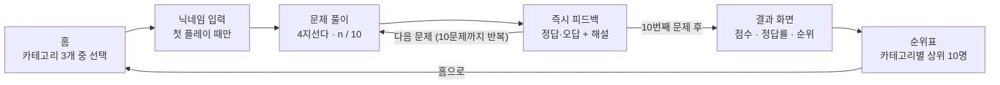

# 철강 퀴즈 게임 PRD

2026-09-29 · jeongyong.lee.89@gmail.com

## 1. 개요

철강 퀴즈 게임은 시장·기술·제품 3개 카테고리, 총 120문제(카테고리별 40문제)에서 한 판에 10문제씩 무작위로 출제하는 4지선다 퀴즈로 철강 지식을 재미있게 익히게 하는 웹 게임이다. 사용자는 카테고리를 골라 바로 풀이를 시작하고, 매 문항 정답/오답 피드백을 즉시 받으며, 최종 점수를 순위표에 남긴다.

**목표**

- 철강 산업의 시장 동향, 공정 기술, 제품 지식을 짧은 시간에 학습하게 한다.
- 즉시 피드백과 해설로 틀린 문제에서도 학습이 일어나게 한다.
- 점수·순위 경쟁으로 반복 참여를 유도한다.

## 2. 대상 사용자

| 사용자 | 목적 | 주요 사용 장면 |
| --- | --- | --- |
| 철강사 신입·저연차 직원 | 직무 기초 지식 습득 | 입문 교육, 자가 학습 |
| 영업·마케팅 담당자 | 시장·제품 지식 점검 | 고객 응대 전 복습 |
| 교육 담당자 | 학습 성취 확인 | 사내 교육 후 퀴즈 이벤트 |
| 철강 산업에 관심 있는 일반인·학생 | 흥미 위주 학습 | 취업 준비, 교양 |

**대표 시나리오**: 신입 직원이 점심시간에 '제품' 카테고리를 선택해 10문제를 풀고, 틀린 문제의 해설을 읽은 뒤 순위표에서 동기들과 점수를 비교한다.

## 3. 게임 규칙과 기능 요구사항

한 판은 선택한 카테고리의 40문제 중 무작위로 뽑은 10문제를 푸는 것이며, 문항마다 보기 4개 중 정답은 1개다.

| ID | 요구사항 | 상세 | 우선순위 |
| --- | --- | --- | --- |
| F-01 | 카테고리 선택 | 홈 화면에 시장·기술·제품 3개 카드 표시. 카드를 누르면 해당 카테고리 풀이가 즉시 시작된다. | P0 |
| F-02 | 닉네임 입력 | 첫 플레이 전 닉네임(2~12자) 입력. 이후 기억하고 변경 가능. | P0 |
| F-03 | 4지선다 출제 | 문제 순서와 보기 순서를 매 판 무작위로 섞는다. 보기 선택은 1회만 가능. | P0 |
| F-04 | 즉시 피드백 | 선택 즉시 정답(초록)·오답(빨강)을 표시하고, 오답이면 정답 보기도 함께 강조. 1~2문장 해설을 보여준 뒤 '다음 문제' 버튼 노출. | P0 |
| F-05 | 진행 상황 표시 | 'n / 10' 문항 번호, 진행 바, 현재 점수 표시. | P0 |
| F-06 | 최종 결과 | 정답 수, 최종 점수, 정답률, 소요 시간, 이번 순위 표시. | P0 |
| F-07 | 순위 기록 | 최종 점수를 카테고리별 순위표에 자동 저장(6장 규칙). | P0 |
| F-08 | 순위표 조회 | 카테고리 탭별 상위 10명 + 내 최고 기록 표시. | P0 |
| F-09 | 오답 다시보기 | 결과 화면에서 틀린 문제와 해설 목록 열람. | P1 |
| F-10 | 중도 포기 | 풀이 중 나가기 시 확인 팝업. 포기한 판은 순위에 기록하지 않는다. | P1 |
| F-11 | 다시하기 | 결과 화면에서 같은 카테고리 재도전 또는 홈으로 이동. | P1 |

P0 = 출시 필수, P1 = 출시 권장.

## 4. 사용자 흐름과 화면 구성

카테고리를 고르면 바로 문제 풀이가 시작되고, 10문제를 마치면 점수가 순위표에 자동 저장된다.



문제 풀이와 피드백이 10번 반복된 뒤 결과 화면으로 넘어간다. 결과 화면의 '다시하기'는 같은 카테고리를 새로 뽑은 10문제로 다시 시작한다.

| 화면 | 주요 구성 요소 |
| --- | --- |
| 홈 | 게임 타이틀, 카테고리 카드 3개(아이콘·이름·내 최고 점수), 순위표 버튼 |
| 닉네임 입력 | 입력창, 시작 버튼, 글자 수·금칙어 안내 |
| 문제 풀이 | 카테고리명, n / 10, 진행 바, 현재 점수, 문제, 보기 버튼 4개, 나가기 |
| 즉시 피드백 | 문제 화면 위에 표시: 선택 보기 초록/빨강, 정답 보기 강조, 해설, 다음 문제 버튼 |
| 결과 화면 | 점수(100점 만점), 정답 수, 정답률, 소요 시간, 이번 순위, 오답 다시보기, 다시하기, 순위표 |
| 순위표 | 카테고리 탭 3개, 순위·닉네임·점수·소요 시간·날짜, 내 기록 강조 |

## 5. 문제 데이터와 콘텐츠 가이드

문제는 총 120개(3개 카테고리 × 40문제)이며, 코드와 분리된 JSON 파일로 관리해 문제 수정 시 배포만 다시 하면 되게 한다.

| 카테고리 | 문제 수 | 다루는 범위(예시) |
| --- | --- | --- |
| 시장 | 40 | 세계·국내 조강량, 주요 철강사, 원료(철광석·원료탄·고철) 시세, 수급·통상 이슈, 탄소중립 정책 |
| 기술 | 40 | 고로·전기로 공정, 제강·연주·압연, 열처리, 합금 원소, 수소환원제철 등 저탄소 기술 |
| 제품 | 40 | 열연·냉연·도금강판, 후판, 철근, 형강, 강관, 자동차용 강판, 스테인리스, 용도·규격 |

**문제 데이터 형식**

```json
{
  "id": "TEC-001",
  "category": "tech",
  "question": "고로에서 철광석을 환원하는 데 주로 쓰이는 연료는?",
  "choices": ["코크스", "천연가스", "중유", "우라늄"],
  "answerIndex": 0,
  "explanation": "코크스는 열원이자 환원제로 철광석의 산소를 제거한다.",
  "difficulty": "easy"
}
```

**콘텐츠 작성 원칙**

- 정답은 하나만 명확하고, 오답 보기도 그럴듯해야 한다. '모두 정답'·'정답 없음' 보기는 쓰지 않는다.
- 모든 문제에 1~2문장 해설을 단다.
- 카테고리별 난이도 비율은 쉬움 15 · 보통 15 · 어려움 10문제를 권장한다.
- 시세·생산량 등 변하는 수치는 기준 연도를 문제에 명시하고, 연 1회 검토한다.
- 모든 문제는 현업 전문가 1인 이상의 검수를 거친다.

## 6. 점수 및 순위 규칙

정답 1개당 10점, 오답은 0점(감점 없음)으로 한 판 만점은 100점이다.

| 항목 | 규칙 |
| --- | --- |
| 점수 | 정답 수 × 10점 (0~100점) |
| 정답률 | 정답 수 ÷ 10 × 100 (%) |
| 순위 단위 | 카테고리별 별도 순위표 3개 |
| 정렬 | 점수 높은 순 → 같으면 소요 시간 짧은 순 → 같으면 먼저 기록한 순 |
| 기록 단위 | 닉네임별 카테고리 최고 기록 1개만 순위표에 반영 |
| 저장 항목 | 닉네임, 카테고리, 점수, 정답 수, 소요 시간(초), 기록 일시 |
| 표시 | 상위 10명 + 내 순위(10위 밖이어도 표시) |
| 제외 | 중도 포기한 판, 10문제를 끝까지 풀지 않은 판 |

문항별 제한 시간과 빠른 응답 가산점은 MVP에서 제외하고 8장 미결 사항으로 둔다.

## 7. 비기능 요구사항

| 구분 | 요구사항 |
| --- | --- |
| 플랫폼 | 웹 브라우저(Chrome·Edge·Safari 최신 2개 버전), PC와 모바일 반응형 (최소 폭 360px) |
| 성능 | 첫 화면 로딩 2초 이내, 보기 선택 후 피드백 표시 0.2초 이내 |
| 접근성 | 정답/오답을 색상만이 아니라 아이콘(✓/✗)과 문구로도 표시, 키보드(1~4 키)로 보기 선택 가능 |
| 데이터 | 문제는 JSON으로 분리, 순위 기록은 새로고침해도 유지 |
| 부정 방지 | 닉네임 금칙어 필터, 비정상 점수(100점 초과, 소요 시간이 문제당 평균 1초 미만(10문제 기준 10초)) 기록 차단 |
| 개인정보 | 닉네임 외 개인정보 수집 없음 |

## 8. 성공 지표, 범위, 미결 사항

**성공 지표** (목표치는 출시 후 기준값을 보고 확정)

- 판 완주율: 시작한 판 중 10문제를 끝까지 푼 비율
- 재플레이율: 같은 사용자가 2판 이상 플레이한 비율
- 반복 플레이 시 정답률 변화(학습 효과)
- 문항별 정답률(너무 쉽거나 어려운 문제 개선용)

**MVP 범위 외**

- 회원가입·로그인, 사내 계정 연동
- 관리자 문제 편집 화면 (JSON 직접 수정으로 대신)
- 실시간 대전, 보상·배지, 다국어

**미결 사항**

- [ ] 순위 저장 방식: 브라우저 로컬 저장(개인 기기 내 순위) vs 서버 DB(전체 공유 순위)?
- [x] 한 판 문제 수: 40문제 풀에서 10문제를 무작위로 뽑는다 (2026-09-29 결정)
- [ ] 문항별 제한 시간(예: 20초)과 빠른 응답 가산점을 도입할지?
- [ ] 전 카테고리 통합 순위표가 필요한지?
- [ ] 120문제 출제·검수 담당자와 일정은?
